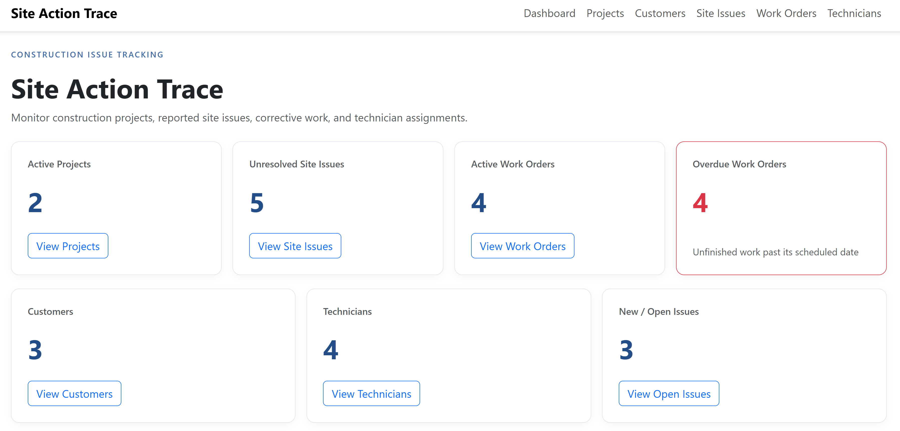
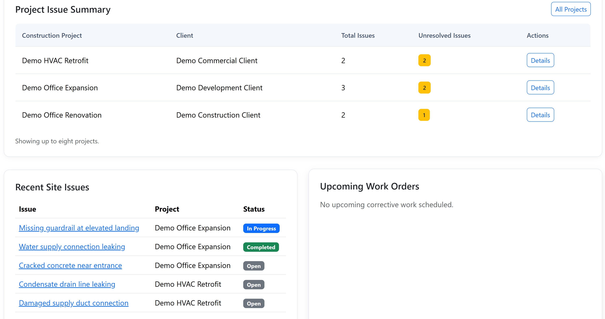
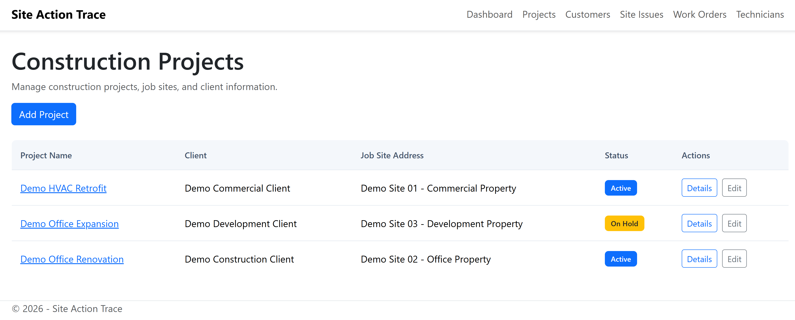
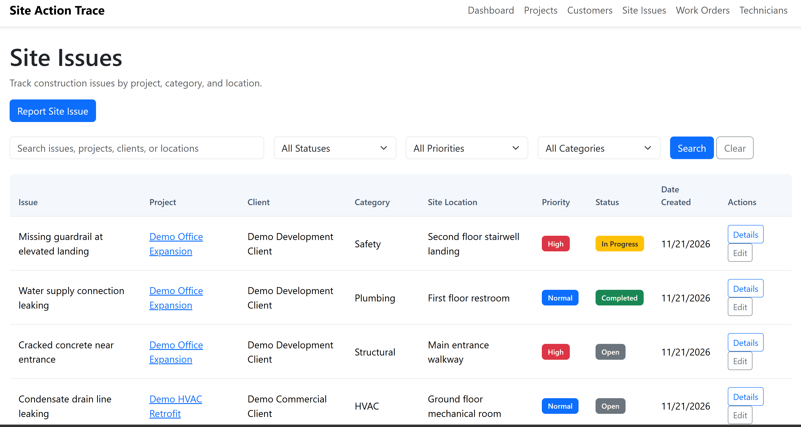
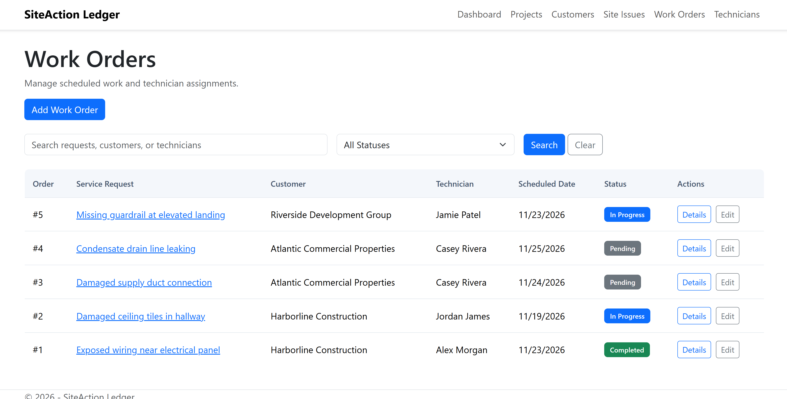

# Site Action Trace

Site Action Trace is a construction site issue and corrective-action tracking application built with C# and ASP.NET Core MVC.

It connects construction projects, customers, site issues, technicians, and work orders to help manage reported problems and track corrective work through completion.

## Project Motivation

This project was inspired by my experience working for a construction and engineering company, where I worked with databases and assisted with cloud migration. I wanted to apply that experience to developing an application that connects construction projects, reported site issues, and corrective work through a relational database.

## Screenshots

### Dashboard


### Project Issue Summary


### Construction Projects


### Site Issues


### Work Orders


## Features

- **Customer Management:** Create, view, edit, search, and manage customer records.
- **Construction Projects:** Associate projects with customers, manage job site details, and track project statuses.
- **Site Issue Tracking:** Report issues with categories, priorities, site locations, and descriptions.
- **Search and Filtering:** Search site issues and work orders, with status filters and additional priority and category filters for site issues.
- **Work Orders:** Schedule corrective work, assign technicians, and track progress.
- **Completion Tracking:** Require resolution notes, record completion dates, and synchronize work-order and site-issue statuses.
- **Technician Management:** Manage technician information and assigned work orders.
- **Dashboard:** Monitor active projects, unresolved issues, upcoming work orders, overdue work, and project summaries.
- **Data Validation:** Protect related records, validate assignments, and prevent duplicate work orders.

## Technologies

- C# and .NET 10
- ASP.NET Core MVC
- Razor Views
- Entity Framework Core 10
- SQLite
- LINQ
- Bootstrap
- HTML and CSS
- xUnit

## Getting Started

### Requirements

- .NET 10 SDK or a compatible newer SDK
- .NET 10 ASP.NET Core runtime
- Visual Studio with ASP.NET and web development support

### Setup

1. Clone or download the repository.
2. Open `SiteActionTrace.slnx` in Visual Studio.
3. Restore NuGet packages if prompted.
4. Open **Tools → NuGet Package Manager → Package Manager Console**.
5. Select `SiteActionTrace` as the default project.
6. Run:

```powershell
Update-Database
```

7. Set `SiteActionTrace` as the startup project.
8. Run the application using the HTTPS launch profile.

The application uses a local SQLite database named `siteactiontrace.db`, which is excluded from Git. A newly created database starts empty; records can be added through the application.

## Automated Tests

The project includes 22 automated tests covering data relationships, validation, site issue creation, technician assignments, and work-order status changes.

Run the tests through Visual Studio Test Explorer or:

```bash
dotnet test SiteActionTrace.Tests/SiteActionTrace.Tests.csproj
```

## Example Workflow

1. Create a customer and construction project.
2. Report a site issue for the project.
3. Assign a technician through a work order.
4. Schedule and track the corrective work.
5. Record resolution notes and complete the work order.
6. Review the updated issue status and dashboard.

## Project Structure

- `Controllers/` — Application workflows and request handling
- `Models/` — Data models and view models
- `Data/` — Entity Framework Core database context
- `Migrations/` — Database migrations
- `Views/` — Razor views
- `wwwroot/` — Styles and static assets
- `SiteActionTrace.Tests/` — Automated tests
- `Screenshots/` — Application screenshots

## Demonstration Data

All demonstration records, including those appearing in earlier versions of this repository, were created for software testing and demonstration purposes. Any resemblance to actual individuals, businesses, properties, or incidents is coincidental.

## Project Scope

Site Action Trace is a locally run application demonstrating C# development, ASP.NET Core MVC, relational database design, CRUD operations, validation, and automated testing.

This is a personal project inspired by professional experience and is not affiliated with or endorsed by any current or former employer.